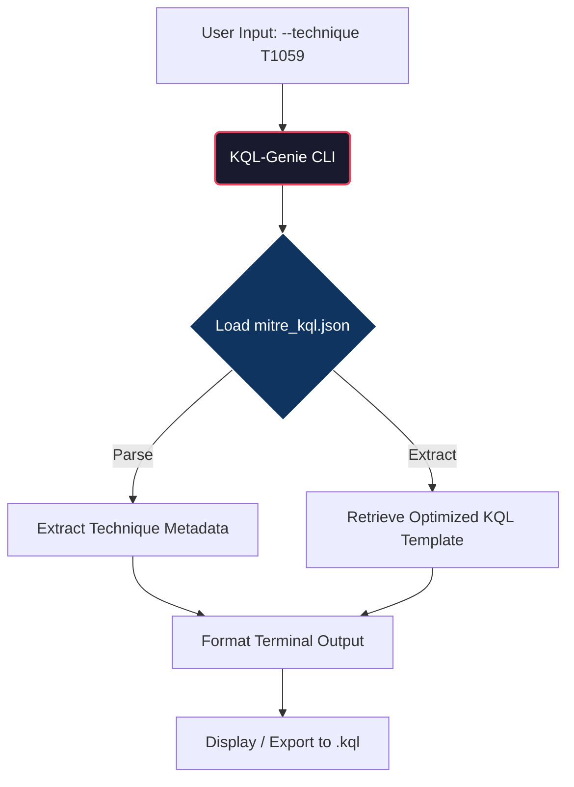

# 🛡️ KQL-Genie: MITRE ATT&CK to Sentinel Mapper

[](https://www.python.org/)
[](https://opensource.org/licenses/MIT)
[](#)
[](https://github.com/saadcyber21/kql-genie/actions)

> **A zero-dependency, deterministic CLI tool** that instantly generates production-ready Microsoft Sentinel KQL hunting queries mapped directly to MITRE ATT&CK techniques.

---

## ⚡ The Challenge
SOC analysts and detection engineers spend countless hours translating MITRE ATT&CK tactics into functional KQL queries. Generic online generators produce bloated, inefficient queries that fail to account for specific Sentinel table schemas (e.g., `SigninLogs`, `SecurityEvent`, `OfficeActivity`), leading to high false-positive rates and alert fatigue.

## 🚀 The Solution
**KQL-Genie** provides a curated, lightweight mapping engine. Instead of relying on external APIs or heavy frameworks, it uses a local, version-controlled JSON database to instantly output optimized, copy-paste-ready KQL queries tailored for Microsoft Sentinel.

---

## 🏗️ Architecture



---

## 🔧 Installation & Usage

**Zero external dependencies required.** Built entirely with Python standard libraries (`argparse`, `json`, `os`, `sys`) for seamless execution in air-gapped or highly restricted enterprise environments.

```bash
# 1. Clone the repository
git clone https://github.com/YOUR_USERNAME/kql-genie.git
cd kql-genie

# 2. Run the tool (No pip install required!)
python main.py --help
```

### 📋 List Available Techniques
```bash
python main.py --list
```
**Output:**
```text
🛡️  Available MITRE ATT&CK Techniques:

  T1059  | Command and Scripting Interpreter
  T1110  | Brute Force
  T1078  | Valid Accounts
  T1566  | Phishing
  T1003  | OS Credential Dumping
```

### 🔍 Generate a Specific Query
```bash
python main.py --technique T1059
```
**Output:**
```text
🎯 Technique: T1059 - Command and Scripting Interpreter
📝 Description: Adversaries may abuse command and script interpreters...

🔍 Generated KQL Query:
----------------------------------------------------------------------
SecurityEvent
| where EventID == 4688 // Process Creation
| where Process has_any ("powershell.exe", "cmd.exe", "bash", "sh")
...
----------------------------------------------------------------------
💡 Tip: Adjust the time range and table names based on your environment.
```

### 💾 Export to File
```bash
python main.py --export T1110
# Output: [+] Successfully exported to T1110_hunting_query.kql
```

---

## 🛡️ Why This Matters for Enterprise SOC
1. **Air-Gapped Ready**: No `pip install`, no external API calls. Runs entirely offline.
2. **Deterministic**: Guarantees the exact same output every time, unlike LLM-based generators.
3. **Extensible**: Easily add your organization's custom detection logic to `mitre_kql.json` and version-control it alongside your CI/CD pipeline.

---

## 🤝 Contributing
Want to add a new MITRE technique or optimize a KQL query? 
1. Fork the repository.
2. Add your technique to `mitre_kql.json`.
3. Submit a Pull Request. The GitHub Actions workflow will automatically validate your JSON syntax and CLI execution.

## 📄 License
This project is licensed under the MIT License.

---
*Built for SOC Analysts, Detection Engineers, and Threat Hunters.*
